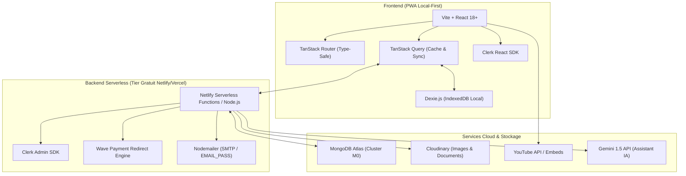
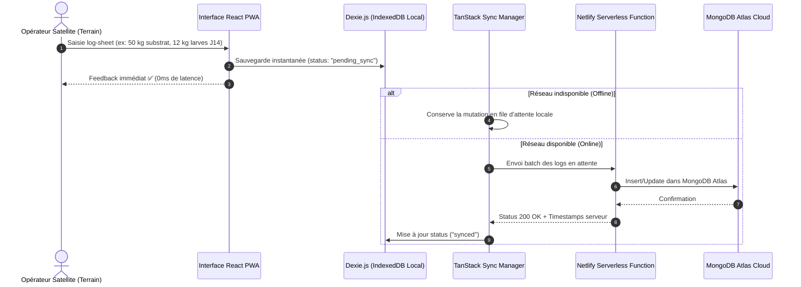

# ⚙️ Spécification Technique 01 — Architecture & Stack Technique

## 1. Vue d'Ensemble

La plateforme **BSF Bioconversion** (nom de marque proposé : **ReWaste BSF** / **Wastify**) est une application web hybride local-first combinant :
1. Un **Portail Pédagogique & Marketing** (LMS gratuit, BSF Calculator, Wizard de diagnostic, Glossaire).
2. Un **E-Commerce & Gestion des Inscriptions** (Abonnements 5-DOL, kits matériels, bioproduits, pré-inscriptions aux formations).
3. Un **SaaS "Colony Manager" Local-First** (Suivi d'élevage et de nurserie terrain pour partenaires satellites, fonctionnant 100% hors-ligne).
4. Un **Portail B2B & Municipal** (Traçabilité des gisements de biodéchets, certificats d'impact, facturation des Gate Fees).

---

## 2. Stack Technique Détillée



| Composant | Technologie | Variables d'Environnement Associées |
|---|---|---|
| **Bundler / PWA** | Vite + React 18 | `VITE_APP_URL` / `BASE_URL` |
| **Routing** | TanStack Router | — |
| **Gestion d'État & Cache** | TanStack Query (v5) | — |
| **Base Locale (Offline)** | Dexie.js (IndexedDB) | — |
| **Base Cloud Server** | MongoDB Atlas (M0 Shared) | `MONGODB_URI` |
| **Authentification** | Clerk Auth | `NEXT_PUBLIC_CLERK_PUBLISHABLE_KEY`, `CLERK_SECRET_KEY`, `CLERK_WEBHOOK_SECRET` |
| **Paiements Mobile Money** | API Wave CI (Lien Direct) | `MY_WAVE_URI` (`https://pay.wave.com/m/M_ci_hsvjN_ywTw2K/c/ci/?amount=`) |
| **Gestion Admins** | Multi-Email Super-Admin | `EMAIL_ADMIN` (`hi.cyril@gmail.com puissancedamour@yahoo.fr...`) |
| **Service Email** | Nodemailer / SMTP | `EMAIL_PASS` |
| **Stockage Médias** | Cloudinary | `CLOUDINARY_CLOUD_NAME`, `CLOUDINARY_API_KEY`, `CLOUDINARY_API_SECRET` |
| **Intelligence Artificielle** | Google Gemini API | `GEMINI_API_KEY` |
| **Vidéos LMS** | YouTube Embed (Public/Unlisted) | — |

---

## 3. Stratégie Offline-First (Dexie.js ↔ MongoDB Atlas)

### 3.1 Pourquoi Dexie.js ?
Les partenaires satellites BSF situés en zones rurales du sud de la Côte d'Ivoire (ex: Azaguié, Dabou, Aboisso) font face à des coupures réseau récurrentes. L'application doit permettre la saisie continue des pesées, températures, taux d'humidité et mortalités sans latence ni perte de données.

### 3.2 Workflow de Synchronisation


---

## 4. Intégration des Paiements Mobile Money (Wave)

Pour les achats de produits ou le paiement des formations, le paiement s'effectue directement via Wave Côte d'Ivoire grâce au système de lien dynamique paramétré :

```typescript
// Pattern d'intégration Wave Côte d'Ivoire
export const getWavePaymentUrl = (amountFcfa: number, orderId: string): string => {
  const baseUrl = process.env.MY_WAVE_URI || 'https://pay.wave.com/m/M_ci_hsvjN_ywTw2K/c/ci/?amount=';
  return `${baseUrl}${amountFcfa}&memo=COMMANDE_${orderId}`;
};
```

---

## 5. Rôles et Droits Utilisateurs (Clerk `publicMetadata`)

Les autorisations s'appuient sur Clerk. Les emails définis dans `EMAIL_ADMIN` reçoivent automatiquement le rôle `SUPER_ADMIN`.

```typescript
export type UserRole = 
  | 'VISITOR'           // Visiteur anonyme (accès cours gratuits, tools)
  | 'LEARNER'           // Apprenant inscrit aux cours/lives
  | 'CLIENT'            // Client e-commerce (intrants, bioproduits)
  | 'SATELLITE_PARTNER' // Opérateur de ferme satellite (accès Colony Manager)
  | 'B2B_MUNICIPAL'     // Client apporteur de déchets (Portail Gate Fees)
  | 'SUPER_ADMIN';      // Administrateur plateforme (hi.cyril@gmail.com, etc.)
```

---

## 6. Hébergement & Déploiement

- **Frontend & Functions** : Déploiement automatisé sur **Netlify** via Git CI/CD.
- **Domaine** : Configuration DNS HTTPS sécurisée.
- **Variables d'environnement** : Injectées via l'interface Netlify depuis `.env`.
